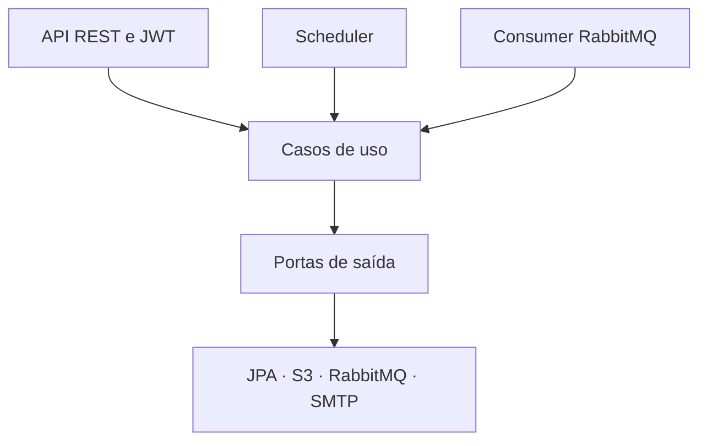
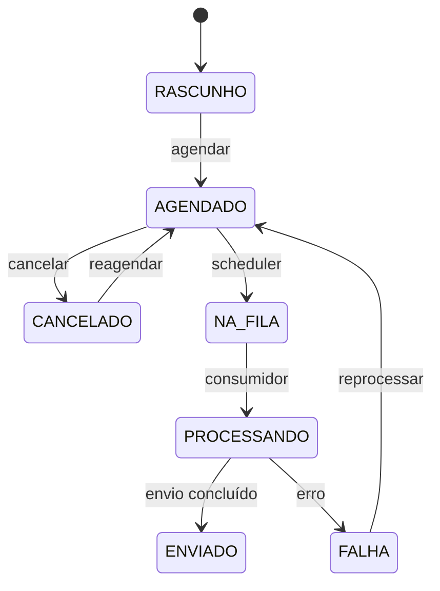

<div align="center">

# Scheduled File Dispatch

### API para agendar o envio de e-mails com anexos, mensageria e rastreamento distribuído

Uma aplicação em **Java 21 e Spring Boot 4** que recebe arquivos, agenda mensagens e executa o envio de forma assíncrona. O projeto reúne arquitetura hexagonal, autenticação JWT, PostgreSQL, RabbitMQ, armazenamento S3 emulado, Resilience4j e tracing com OpenTelemetry.


</div>

## Sumário

- [Visão geral](#visão-geral)
- [Funcionalidades](#funcionalidades)
- [Arquitetura](#arquitetura)
- [Modelo de dados e estados](#modelo-de-dados-e-estados)
- [Tecnologias](#tecnologias)
- [Como executar](#como-executar)
- [Variáveis de ambiente](#variáveis-de-ambiente)
- [API REST](#api-rest)
- [Exemplo de uso](#exemplo-de-uso)
- [Observabilidade](#observabilidade)
- [Resiliência e processamento assíncrono](#resiliência-e-processamento-assíncrono)
- [Verificação manual](#verificação-manual)
- [Decisões e limites](#decisões-e-limites)

## Visão geral

O **Scheduled File Dispatch** permite que um usuário autenticado prepare um e-mail, adicione até três anexos, escolha uma data futura e deixe o envio a cargo da aplicação. Um scheduler encontra os agendamentos vencidos e publica seus identificadores no RabbitMQ. O consumidor recupera os anexos do armazenamento S3 emulado e envia a mensagem por SMTP; durante o desenvolvimento, o Mailpit recebe os e-mails sem entregá-los a caixas externas.

O domínio é simples de propósito: o foco do projeto está na integração entre componentes, no isolamento das regras por meio de portas e adapters e no acompanhamento do fluxo assíncrono por traces.

### Fluxo principal

1. O usuário se cadastra, faz login e recebe um JWT.
2. Cria um rascunho com destinatário, assunto e corpo.
3. Envia os anexos; o conteúdo vai para o S3 emulado e os metadados ficam no PostgreSQL.
4. Agenda o envio para um instante futuro.
5. O scheduler publica o ID do envio vencido no RabbitMQ.
6. O consumidor baixa os anexos, monta o e-mail e o envia ao Mailpit.
7. O resultado fica disponível na consulta do envio: `ENVIADO` ou `FALHA`.

## Funcionalidades

| Área | Recursos implementados |
| --- | --- |
| Conta e segurança | Cadastro com senha protegida por BCrypt, autenticação JWT, API sem sessão e acesso aos envios restrito ao proprietário. |
| Rascunhos | Criação, listagem, consulta, edição e exclusão. |
| Anexos | Upload multipart, download e remoção; até **3 anexos por envio**, com **5 MB por arquivo**. |
| Agendamento | Definição de data futura, cancelamento antes do enfileiramento e reagendamento de envio cancelado. |
| Processamento | Busca periódica de envios vencidos, publicação no RabbitMQ e consumidor SMTP. |
| Recuperação | Tratamento de falhas, reprocessamento manual e recuperação de estados abandonados. |
| Operação | Serviços locais via Docker Compose, rastreamento distribuído e circuit breakers nas integrações externas. |

## Arquitetura

O projeto segue o estilo **hexagonal**: os casos de uso conhecem contratos de saída, enquanto os detalhes de HTTP, banco, mensageria, armazenamento e e-mail ficam nos adapters. A configuração do Spring conecta as implementações aos casos de uso.



| Pacote | Responsabilidade |
| --- | --- |
| `application.domain` | `Usuario`, `Envio`, `AnexoEnvio`, estados e exceções do domínio. |
| `application.usecases` | Os 14 casos de uso e suas regras de transição. |
| `application.port.out` | Contratos de persistência, arquivos, mensagens, e-mail, senha e token. |
| `adapter.in.web` | Endpoints HTTP, validação de entrada e tratamento de erros. |
| `adapter.in.scheduler` / `adapter.in.rabbit` | Disparo periódico e consumo de mensagens. |
| `adapter.out.jpa` | Entidades, repositories Spring Data e mapeamento para o domínio. |
| `adapter.out.s3` / `adapter.out.mail` / `adapter.out.rabbit` / `adapter.out.security` | Integrações externas e mecanismos de segurança. |
| `config` | Composição dos casos de uso e configuração de infraestrutura. |

## Modelo de dados e estados

- **Usuário:** identificação, nome, e-mail único e hash da senha.
- **Envio:** pertence a um usuário e contém destinatário, assunto, corpo, horários e status.
- **Anexo:** guarda nome original, tipo MIME, tamanho e chave do objeto armazenado no S3. Os bytes não ficam no PostgreSQL.

Na persistência, `EnvioJpaEntity` possui um relacionamento `@OneToMany` com `AnexoJpaEntity`. O identificador do usuário associa cada envio ao seu proprietário.



| Estado | Significado |
| --- | --- |
| `RASCUNHO` | Pode ser editado, excluído e ter anexos alterados. |
| `AGENDADO` | Aguarda a data definida pelo usuário. |
| `NA_FILA` | Foi selecionado pelo scheduler para publicação e processamento. |
| `PROCESSANDO` | Um consumidor assumiu o envio. |
| `ENVIADO` | O SMTP aceitou a mensagem. |
| `FALHA` | O processamento não foi concluído; permite reprocessamento manual. |
| `CANCELADO` | O agendamento foi cancelado antes do enfileiramento. |

## Tecnologias

| Tecnologia | Papel no projeto |
| --- | --- |
| Java 21 e Spring Boot 4.2.0 | Linguagem e base da aplicação. |
| Spring Web MVC e Validation | API REST, multipart e validação de requisições. |
| Spring Data JPA e PostgreSQL 17 | Persistência de usuários, envios e metadados dos anexos. |
| Spring Security e OAuth2 Resource Server | Proteção da API e validação dos JWTs emitidos pela aplicação. |
| Spring AMQP e RabbitMQ 4.2 | Publicação, confirmação e consumo assíncrono dos envios. |
| AWS SDK for Java 2 e LocalStack | Operações S3 em ambiente local. |
| Spring Mail e Mailpit | Envio SMTP e visualização local dos e-mails. |
| Resilience4j | Retry e circuit breaker nas operações S3; circuit breaker no SMTP. |
| Micrometer Tracing, OpenTelemetry e Jaeger | Instrumentação, propagação de contexto e visualização dos traces. |
| Docker Compose e Maven Wrapper | Infraestrutura local e execução do build. |

## Como executar

### Pré-requisitos

- **JDK 21** configurado no terminal ou na IDE.
- **Docker Desktop** ou Docker Engine com Compose.
- Um **token válido do LocalStack** para a imagem configurada no `docker-compose.yaml`.
- Portas locais disponíveis para API e serviços, ou ajustes correspondentes no `.env`.

> O Compose sobe a infraestrutura; a aplicação Spring é executada no host. Por isso, os endpoints do `.env.example` usam `localhost`.

### 1. Clonar e configurar

```bash
git clone https://github.com/felipematheus1337/scheduled-file-dispatch.git
cd scheduled-file-dispatch
```

No **PowerShell**:

```powershell
Copy-Item .env.example .env
```

No **Linux/macOS**:

```bash
cp .env.example .env
```

Edite `.env` e substitua, principalmente, `POSTGRES_PASSWORD`, `RABBITMQ_PASSWORD`, `LOCALSTACK_AUTH_TOKEN` e `JWT_SECRET`. Use um segredo JWT aleatório com **pelo menos 32 bytes**. O `.env` está no `.gitignore`.

### 2. Subir a infraestrutura

```bash
docker compose --env-file .env config
docker compose --env-file .env up -d
docker compose --env-file .env ps
```

O serviço `s3-init` é executado uma vez para criar o bucket. É esperado que ele termine após concluir essa tarefa; confirme que não houve erro nos logs:

```bash
docker compose --env-file .env logs s3-init
```

### 3. Executar a aplicação

No **PowerShell**:

```powershell
.\mvnw.cmd spring-boot:run
```

No **Linux/macOS**:

```bash
bash mvnw spring-boot:run
```

Com os valores padrão, a API fica em `http://localhost:8080`. O endpoint `GET /actuator/health` pode ser usado para conferir se a aplicação iniciou.

### Interfaces locais

| Serviço | Endereço padrão | Uso |
| --- | --- | --- |
| API | `http://localhost:8080` | Endpoints REST. |
| RabbitMQ Management | `http://localhost:15672` | Inspeção das filas; credenciais do `.env`. |
| Mailpit | `http://localhost:8025` | Visualização dos e-mails enviados. |
| Jaeger | `http://localhost:16686` | Busca de traces do serviço `scheduled-file-dispatch`. |
| LocalStack S3 | `http://localhost:4566` | Endpoint usado pelo AWS SDK. |

Para parar a infraestrutura:

```bash
docker compose --env-file .env down
```

## Variáveis de ambiente

O arquivo [`.env.example`](./.env.example) reúne os nomes e valores de exemplo. Os dados sensíveis devem ficar somente no `.env` local.

| Variável | Finalidade | Exemplo / padrão local |
| --- | --- | --- |
| `POSTGRES_DB`, `POSTGRES_USER`, `POSTGRES_PASSWORD` | Banco, usuário e senha do PostgreSQL. | `scheduled_file_dispatch`, `dispatch`, valor privado. |
| `POSTGRES_HOST`, `POSTGRES_PORT` | Acesso da aplicação ao banco. | `localhost`, `5432`. |
| `RABBITMQ_USER`, `RABBITMQ_PASSWORD` | Credenciais do broker e do painel. | `dispatch`, valor privado. |
| `RABBITMQ_HOST`, `RABBITMQ_PORT` | Conexão AMQP da aplicação. | `localhost`, `5672`. |
| `RABBITMQ_MANAGEMENT_PORT` | Porta da interface administrativa. | `15672`. |
| `LOCALSTACK_AUTH_TOKEN` | Autorização exigida pela imagem LocalStack configurada. | Token válido da sua conta. |
| `LOCALSTACK_PORT` | Porta da API emulada. | `4566`. |
| `S3_BUCKET`, `S3_ENDPOINT`, `S3_REGION` | Nome do bucket e conexão S3. | `scheduled-file-dispatch`, `http://localhost:4566`, `us-east-1`. |
| `S3_ACCESS_KEY`, `S3_SECRET_KEY` | Credenciais locais usadas pelo SDK e pelo `s3-init`. | `test`, `test`. |
| `MAIL_HOST`, `MAIL_SMTP_PORT`, `MAIL_FROM` | SMTP e remetente da aplicação. | `localhost`, `1025`, `no-reply@scheduled-file-dispatch.local`. |
| `MAIL_UI_PORT` | Interface do Mailpit. | `8025`. |
| `JWT_SECRET` | Assinatura HS256 dos tokens; mínimo de 32 bytes. | Valor aleatório privado. |
| `OTLP_TRACES_ENDPOINT` | Destino dos traces OTLP. | `http://localhost:4318/v1/traces`. |
| `OTLP_HTTP_PORT`, `JAEGER_UI_PORT` | Portas do collector e da interface Jaeger. | `4318`, `16686`. |

## API REST

`/api/auth/**` é público. As demais rotas exigem `Authorization: Bearer <token>`. O UUID do usuário é obtido do `sub` do JWT; não é enviado pelo cliente no corpo das operações de envio.

Os tokens são assinados com **HS256**, têm emissor `scheduled-file-dispatch` e expiram após **1 hora**. As senhas são armazenadas com BCrypt, nunca como texto puro.

### Autenticação

| Método | Rota | Descrição |
| --- | --- | --- |
| `POST` | `/api/auth/register` | Cadastra usuário; retorna `201` com seu UUID. |
| `POST` | `/api/auth/login` | Autentica e retorna `{ "token": "...", "tipo": "Bearer" }`. |

### Envios

| Método | Rota | Descrição |
| --- | --- | --- |
| `POST` | `/api/envios` | Cria rascunho; retorna `201`. |
| `GET` | `/api/envios` | Lista os envios do usuário autenticado. |
| `GET` | `/api/envios/{id}` | Consulta um envio do usuário. |
| `PUT` | `/api/envios/{id}` | Edita destinatário, assunto e corpo de um rascunho. |
| `DELETE` | `/api/envios/{id}` | Exclui um rascunho; retorna `204`. |
| `POST` | `/api/envios/{id}/agendar` | Agenda ou reagenda para um instante futuro. |
| `POST` | `/api/envios/{id}/cancelar` | Cancela um envio ainda `AGENDADO`. |
| `POST` | `/api/envios/{id}/reprocessar` | Reagenda um envio em `FALHA`. |

### Anexos

| Método | Rota | Descrição |
| --- | --- | --- |
| `POST` | `/api/envios/{id}/anexos` | Multipart com campo `arquivo`; retorna `201`. |
| `GET` | `/api/envios/{id}/anexos/{anexoId}` | Faz download do arquivo. |
| `DELETE` | `/api/envios/{id}/anexos/{anexoId}` | Remove o anexo do rascunho; retorna `204`. |

Os identificadores inválidos ou alheios ao usuário não dão acesso ao conteúdo de outro proprietário. As regras de estado retornam conflito (`409`); entradas inválidas retornam erro de cliente (`400`); credenciais de login incorretas retornam `401`.

## Exemplo de uso

As requisições abaixo podem ser adaptadas para o cliente HTTP da IDE, Postman ou Insomnia. Substitua os UUIDs e o token pelas respostas obtidas nas etapas anteriores.

### Cadastro e login

```http
POST http://localhost:8080/api/auth/register
Content-Type: application/json

{
  "nome": "Felipe",
  "email": "felipe@example.test",
  "senha": "minha-senha-local-segura"
}
```

```http
POST http://localhost:8080/api/auth/login
Content-Type: application/json

{
  "email": "felipe@example.test",
  "senha": "minha-senha-local-segura"
}
```

### Criar um rascunho

```http
POST http://localhost:8080/api/envios
Authorization: Bearer <TOKEN>
Content-Type: application/json

{
  "destinatarioEmail": "destinatario@example.test",
  "assunto": "Arquivo agendado",
  "corpo": "Olá! Segue o arquivo em anexo."
}
```

Guarde o `id` retornado. Para enviar um arquivo, use o campo multipart `arquivo`:

```bash
curl -X POST "http://localhost:8080/api/envios/<ID_DO_ENVIO>/anexos" \
  -H "Authorization: Bearer <TOKEN>" \
  -F "arquivo=@exemplo.pdf"
```

> No PowerShell, execute o `curl.exe` em uma única linha ou use a continuação de linha própria do PowerShell. O arquivo deve existir no diretório em que o comando for executado.

### Agendar

```http
POST http://localhost:8080/api/envios/<ID_DO_ENVIO>/agendar
Authorization: Bearer <TOKEN>
Content-Type: application/json

{
  "agendadoPara": "2030-01-01T12:00:00Z"
}
```

Escolha um horário **futuro**, em formato ISO 8601; o sufixo `Z` indica UTC. Para observar o fluxo rapidamente, agende alguns minutos à frente: o scheduler executa uma vez por minuto. Consulte `GET /api/envios/{id}` até o status mudar e veja a mensagem no Mailpit.

## Observabilidade

O projeto utiliza **Micrometer Tracing com OpenTelemetry** e exporta traces via **OTLP HTTP** para o Jaeger. A amostragem está em `100%` para facilitar a exploração local; a exportação de métricas OTLP está desativada nesta configuração.

| Ponto do fluxo | Instrumentação |
| --- | --- |
| Requisições HTTP | Observação automática das rotas REST e correlação por `traceId` / `spanId` nos logs. |
| Scheduler | Span `scheduler.envios.vencidos` criado ao iniciar a varredura. |
| RabbitMQ | Observação do publisher e do listener, com propagação do contexto pela mensagem. |
| S3 | Spans `storage.s3.put`, `storage.s3.get` e `storage.s3.delete`. |
| SMTP | Span `email.smtp.send`. |

Abra `http://localhost:16686`, selecione o serviço `scheduled-file-dispatch` e pesquise os traces. A criação/agendamento via HTTP e o disparo posterior pelo scheduler são operações iniciadas em momentos diferentes; procure pelos IDs de trace e pelo UUID do envio nos logs ao investigar a jornada completa. O código não adiciona destinatário, corpo, assunto ou credenciais como atributos dos spans.

## Resiliência e processamento assíncrono

| Integração | Estratégia usada |
| --- | --- |
| S3 emulado | `Retry` de até **2 tentativas**, intervalo de **300 ms** e `CircuitBreaker` `s3Storage`. |
| SMTP | `CircuitBreaker` `smtp`; sem retry automático de envio. |
| RabbitMQ | Publisher confirm e detecção de mensagens não roteadas. |
| Banco / consumidor | Transições condicionais de estado para impedir que dois consumidores assumam simultaneamente o mesmo envio. |

Os circuit breakers usam janela de **10 chamadas**, mínimo de **5 chamadas** e limite de **50% de falhas**. O circuito `s3Storage` espera **10 segundos** aberto antes de permitir até **3 chamadas** de avaliação; `smtp` espera **15 segundos** e permite até **2**.

O scheduler recupera envios presos em `NA_FILA` há mais de **5 minutos**, devolvendo-os para nova publicação. Processamentos presos em `PROCESSANDO` há mais de **15 minutos** passam a `FALHA`, estado que permite reprocessamento manual. Em caso de falha no envio, `ultimoErro` registra a categoria da exceção sem guardar o conteúdo da mensagem.

O SMTP não recebe retry automático porque uma resposta de falha ou timeout não garante que a mensagem deixou de ser aceita. O reprocessamento é uma ação explícita sobre um envio em `FALHA`.

## Verificação manual

1. Confirme que `docker compose --env-file .env ps` mostra PostgreSQL, RabbitMQ, LocalStack, Mailpit e Jaeger em execução e que `s3-init` terminou com sucesso.
2. Faça cadastro e login; tente acessar `/api/envios` sem token e com token.
3. Crie, consulte e edite um rascunho; teste o acesso ao ID com outra conta.
4. Adicione um anexo, faça o download e confira a associação no envio.
5. Agende para alguns minutos à frente; acompanhe `AGENDADO → NA_FILA → PROCESSANDO → ENVIADO`.
6. Veja o e-mail e o anexo na interface do Mailpit.
7. Busque o trace no Jaeger e confira os spans do scheduler, RabbitMQ, S3 e SMTP.
8. Para observar uma falha, interrompa temporariamente o Mailpit, faça outro agendamento, confirme `FALHA`, inicie o Mailpit novamente e use `/reprocessar`.

## Decisões e limites

- **PostgreSQL e RabbitMQ não formam uma transação única.** Publisher confirms e recuperação periódica reduzem a chance de um envio ficar parado, mas não criam uma garantia de entrega exatamente uma vez.
- **Há uma janela possível de duplicidade de e-mail** se o SMTP aceitar a mensagem e a aplicação falhar antes de persistir `ENVIADO`. Esse comportamento importa ao decidir reprocessar uma falha.
- **A limpeza de arquivos é uma operação externa ao banco.** Uma falha após a remoção dos metadados pode deixar um objeto órfão no S3 emulado.
- **O schema usa `ddl-auto: update`**, adequado ao laboratório local. Migrações versionadas seriam a evolução natural para outros ambientes.
- **Jaeger usa armazenamento temporário** nesta composição; traces antigos podem desaparecer ao reiniciar o serviço.
- **O LocalStack não possui volume de dados configurado** no Compose. Reiniciar ou recriar seu container pode apagar os objetos emulados, enquanto os metadados do PostgreSQL continuam no volume do banco.

---

<div align="center">

Desenvolvido por [Felipe Matheus](https://github.com/felipematheus1337) como projeto de estudo e portfólio em Java, Spring Boot e integração de sistemas.

</div>
